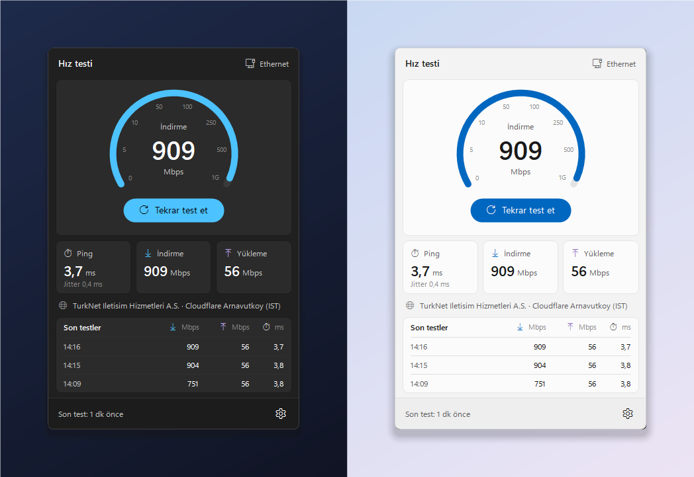

# TaskbarSpeedTest

An internet speed test that lives in the Windows 11 taskbar: the latest download and upload speed right next to the
clock, and a Windows 11 style flyout to run a test.




- **Download**, **upload**, **ping** and **jitter**, measured against Cloudflare's global network
- The result stays in the taskbar, in the clock's font, on two lines like the clock or on one; it updates live
  while a test runs, with a thin progress bar underneath
- Click it for a flyout with a live gauge, the three measurements, the server and your provider, and the last tests
- Optional **automatic tests** (every hour to once a day), skipped while a game or other fullscreen app is in front
- Mbps or MB/s, quick / standard / thorough tests, results copied as text or CSV
- Single ~140 KB exe, no admin rights, no telemetry; English and Turkish

[Türkçe açıklama aşağıda ↓](#türkçe)

## Install

Download `TaskbarSpeedTest-Setup-x.y.z.exe` from [Releases](../../releases) and run it. It installs for your user only
(no UAC prompt) and can start the app when you sign in.

A portable `TaskbarSpeedTest.exe` is attached to each release too; put it anywhere and run it.

Requires Windows 10 or 11 with .NET Framework 4.x (preinstalled).

## Usage

| Action | What it does |
| --- | --- |
| **Click** the taskbar text | Opens the flyout; *Start* / *Test again* runs a test, *Stop* ends it |
| **Hover** | Tooltip with the last result, the server and when it was measured |
| **Right-click** | Windows 11 style menu (below) |
| **Drag** the taskbar text | Fine-tune its position along the taskbar (remembered) |

**Menu**

- *Run a speed test* / *Stop the test*
- *Taskbar*: show the results in the taskbar, show the tray icon as well, which values to show (download, upload,
  ping), two lines like the clock or one line, units, next to the clock or at the left edge
- *Unit*: Mbps or MB/s
- *Test length*: quick (5 s), standard (10 s) or thorough (15 s) for each direction
- *Automatic test*: off, every 1, 3, 6 or 12 hours, or once a day
- *Results*: copy the last result, copy all results as CSV, clear the history
- *Language / Dil*, *Start with Windows*, *Updates*, diagnostic log

From a terminal or a shortcut:

| Command | |
| --- | --- |
| `TaskbarSpeedTest.exe --run` | Starts a test in the running app (or starts the app and tests) |
| `TaskbarSpeedTest.exe --test` | Runs one test in the console and prints the result; exit code 0 when it went through. `--seconds N` sets the length, `--verbose` prints the log |

Settings and the last 20 results live in `HKCU\Software\TaskbarSpeedTest`.

TaskbarSpeedTest lines itself up next to [TaskbarStatus](https://github.com/batuhanbecel/TaskbarStatus) and
[TaskbarLogiBattery](https://github.com/batuhanbecel/TaskbarLogiBattery) when they are running.

## How it measures

Everything goes to `speed.cloudflare.com`, the endpoints behind Cloudflare's own speed test, answered by the nearest
Cloudflare data center.

| | |
| --- | --- |
| **Ping** | 12 TCP handshakes with the server; the median is the ping, the average change between consecutive samples the jitter. A handshake whose SYN had to be resent counts as a lost packet, not as latency |
| **Download** | 6 parallel HTTPS streams, each fetching ~10 MB at a time back to back on a kept-alive connection |
| **Upload** | 4 parallel HTTPS streams posting ~10 MB of random data at a time |

Each direction runs for the chosen length; the speed is the average over the steady part, leaving out the first
quarter (connection setup and TCP slow start). The gauge shows the speed over the last second.

Cloudflare limits how often large transfers can be requested (requests of 10 MB and more, for about an hour), so the
app keeps each request just under that. If Cloudflare still asks to slow down, the streams switch to smaller requests on
their own, and when nothing gets through the flyout says how long to wait.

A test moves real data: at 1 Gbit/s a standard test downloads about 1.2 GB. Keep that in mind on metered connections
and before turning on automatic tests.

## Updates

The app checks GitHub Releases shortly after it starts and then every 6 hours. A new version is downloaded in the
background, verified against the SHA-256 digest GitHub publishes for the release asset and installed silently; the app
restarts itself a few seconds later. Installs wait while a test runs or a fullscreen app is in front. Turn this off
under *Updates → Install automatically in the background*; a found update then appears at the top of the menu.

## Building

No .NET SDK needed; the C# compiler that ships with Windows is used.

```bat
build.bat            :: TaskbarSpeedTest.exe
build-installer.bat  :: dist\TaskbarSpeedTest-Setup-x.y.z.exe (needs Inno Setup 6)
```

`TaskbarSpeedTest.exe --dev` runs a second copy next to the installed one, with its own settings
(`HKCU\Software\TaskbarSpeedTest.Dev`) and no update checks. `--light` / `--dark` force a theme.
`tools\make-icon.ps1` redraws `assets\app.ico`.

The version comes from `src/AssemblyInfo.cs`. Pushing a tag like `v1.0.0` makes GitHub Actions build, sign (if
configured) and publish the release.

| Source | |
| --- | --- |
| `src/SpeedTest.cs` | The measurement: ping, parallel download / upload streams, results |
| `src/App.cs` | Tests, automatic tests, history, menu, updates |
| `src/TaskbarWidget.cs` | The text inside the taskbar |
| `src/Flyout.cs` | The flyout with the gauge |
| `src/Theme.cs`, `src/Win11Menu.cs`, `src/TrayIcon.cs` | Windows 11 colours, fonts, menu and tray icon |
| `src/Cli.cs` | `--test` console mode |

Speed test service by Cloudflare. This project is not affiliated with Cloudflare.

## License

[MIT](LICENSE)

---

## Türkçe

Windows 11 görev çubuğunda yaşayan bir internet hız testi: son indirme ve yükleme hızı saatin hemen yanında, test için
Windows 11 tarzı bir panel.

- **İndirme**, **yükleme**, **ping** ve **jitter**, Cloudflare'in küresel ağına karşı ölçülür
- Sonuç görev çubuğunda, saatle aynı yazı tipinde kalır; saat gibi iki satır ya da tek satır. Test sürerken değerler
  canlı güncellenir, altında ince bir ilerleme çubuğu görünür
- Tıklayınca açılan panelde canlı gösterge, üç ölçüm, sunucu ve servis sağlayıcın, son testler
- İsteğe bağlı **otomatik test** (saatte birden günde bire); oyun ya da tam ekran bir uygulama açıkken atlanır
- Mbps ya da MB/s; hızlı / standart / kapsamlı test; sonuçları metin ya da CSV olarak kopyalama
- Tek bir ~140 KB exe, yönetici izni yok, telemetri yok; Türkçe ve İngilizce

**Kurulum:** [Releases](../../releases) sayfasından `TaskbarSpeedTest-Setup-x.y.z.exe` dosyasını indirip çalıştır.
Sadece senin kullanıcın için kurulur (UAC sormaz) ve istersen oturum açınca başlar. Taşınabilir `TaskbarSpeedTest.exe`
de her sürümde var.

**Kullanım:** Görev çubuğundaki yazıya tıkla, panel açılsın; *Başlat* / *Tekrar test et* testi başlatır, *Durdur*
bitirir. Yazıyı sürükleyerek konumunu ayarlayabilirsin. Sağ tık menüsünde (Windows 11 tarzı): hız testi yap, görev
çubuğu (gösterilecek değerler, iki satır, birimler, saatin yanında / solda), birim (Mbps / MB/s), test süresi, otomatik
test, sonuçlar (son sonucu kopyala, CSV, geçmişi temizle), dil, Windows ile başlat, güncellemeler ve tanılama günlüğü.
`TaskbarSpeedTest.exe --run` çalışan uygulamada test başlatır; `--test` testi konsolda çalıştırıp sonucu yazar.

**Nasıl ölçer:** Ping için sunucuyla 12 TCP el sıkışması yapılır (ortanca değer ping, ardışık örnekler arasındaki
ortalama fark jitter). İndirme 6, yükleme 4 paralel HTTPS akışıyla, her yönde seçilen süre boyunca ölçülür; ilk çeyrek
(bağlantı kurulumu, TCP yavaş başlangıcı) hesaba katılmaz. Cloudflare büyük istekleri (10 MB ve üstü) yaklaşık bir saat
sınırladığı için istekler bu sınırın hemen altında tutulur. Bir test gerçek veri aktarır: 1 Gbit/s hatta standart test
yaklaşık 1,2 GB indirir; kotalı bağlantılarda ve otomatik testi açmadan önce bunu göz önünde bulundur.

**Güncellemeler:** Uygulama açıldıktan kısa süre sonra ve her 6 saatte bir GitHub'a bakar, yeni sürümü arka planda
indirip SHA-256 ile doğrular ve sessizce kurar. Test sürerken ya da tam ekran bir uygulama açıkken kurulum bekler.
